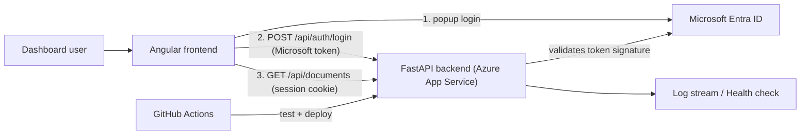

# Architecture

## What is implemented (Aufgabe 2)

Only the building blocks needed for login, logout and one protected document
endpoint are built. They are mapped to the building-block view (level 2):

| Building block | Status | Implementation |
| --- | --- | --- |
| AuditTrail Dashboard | done (minimal) | Angular app in `frontend/`: login button, logout button, button to call the document endpoint |
| IdentityService | done | Microsoft Entra ID (MSAL popup login in `frontend/src/app/auth.service.ts`) |
| AuthenticationGuard | done | `current_user` dependency in `backend/main.py` + token check in `backend/entra.py` |
| AuditController (document interface) | placeholder | `GET /api/documents`, protected, returns `[]` |
| Cloud Logging | basic | Request/error logs in the Azure App Service log stream |
| AuthorizationService, ApiKeyGuard, IngestController, AuditService, AuditStorageService, AlertController, AlertService, Cloud Scheduler, Analysis Worker, Cloud Storage, PostgreSQL | not yet | Later tasks |

**Deviation from the diagram:** the diagram shows NestJS and Google Cloud Identity
Platform. The running application uses FastAPI (Python), Microsoft Entra ID as
identity provider and Azure App Service as cloud. The roles of the blocks stay the
same: an identity service issues the login, a guard protects the API.

## Overview

FastAPI serves the built Angular files and the API from the same address, so the
browser needs no CORS configuration. In development, Angular's proxy forwards
`/api` to Python.

## Login and logout

1. The browser logs in at Microsoft (MSAL, authorization code flow with PKCE) and
   receives an access token for our API (scope `access_as_user`).
2. `POST /api/auth/login` checks the token: Microsoft's signature, issuer, audience,
   tenant, expiry, our frontend client and the scope. If valid, the server creates a
   random session ID and stores it in memory (`backend/auth.py`).
3. The ID is sent as cookie `audittrail_session` (HttpOnly, SameSite=Lax, Secure on HTTPS).
   The Microsoft token is dropped by the browser; nothing is kept in local storage.
4. Every protected endpoint uses the `current_user` dependency: no valid session → **401**.
5. `POST /api/auth/logout` deletes the session on the server. The old cookie is useless afterwards.

## Document interface

`GET /api/documents` is the first document interface. It returns 401 without login
and `200 []` with login. Reading, saving, searching and deleting real documents
(Google Cloud Storage / PostgreSQL in the building-block view) come later.

## Security decisions

| Risk | Measure |
| --- | --- |
| Someone calls the API without logging in | Server-side check on every protected endpoint (hiding buttons is not enough) |
| Stolen or reused session after logout | Random 256-bit session IDs, server-side expiry (1 h), deleted on logout |
| Forged tokens | Signature check against Microsoft's public keys; wrong tenant/audience/client/scope is rejected |
| Another website triggers login/logout (CSRF) | POST requests must come from our own origin (`Origin` header) and the cookie is SameSite=Lax |
| Script reads the session | HttpOnly cookie, no token in browser storage |
| Secrets in Git | None needed: Entra IDs are public, no client secret; `.env` is git-ignored; deployment uses GitHub → Azure OIDC |

Open points for later: roles per user (AuthorizationService), a shared session store
before running more than one instance, and least-privilege access for the team in Azure.

## Quality and operations

- `python -m pytest -v`: integration tests of the HTTP API plus token-validation tests.
- `npm test` in `frontend/`: component tests (login, logout, document call).
- The GitHub workflow runs both and builds Angular before every deployment.
- `/health` tells whether the app runs; request logs and errors are in the Azure log stream.
- Setup, deployment and monitoring steps for the team: [README.md](README.md).
